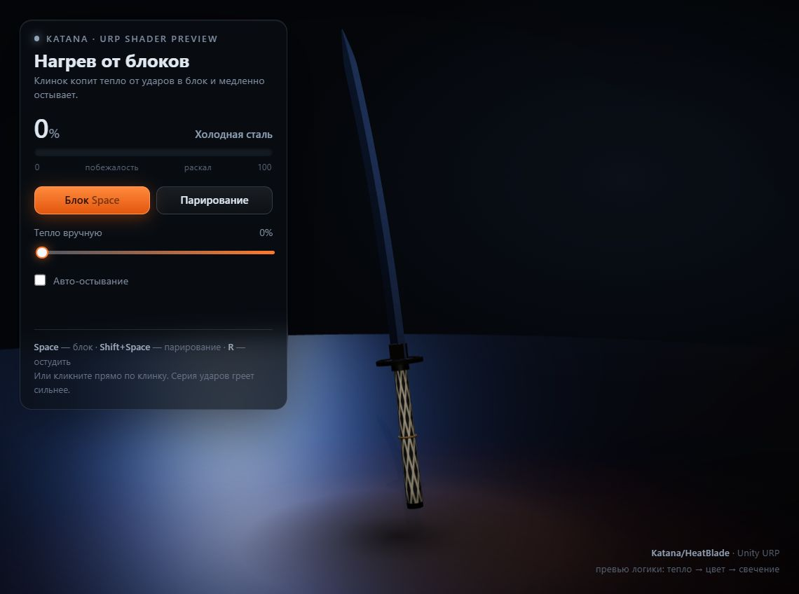
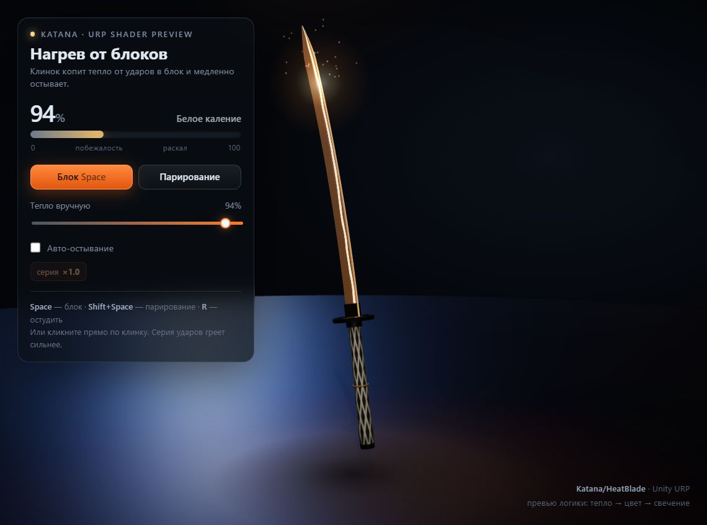

# Катана: нагрев от блоков

Готовый пакет для Unity URP: клинок копит тепло от ударов, принятых в блок,
и постепенно остывает. По мере нагрева меняется цвет металла (побежалость),
затем начинает светиться кромка и линия хамона, появляется дрожание блика,
дымка и искры.

| Холодная сталь | Раскалённый клинок |
|---|---|
|  |  |

```
katana/
├─ Unity/
│  ├─ KatanaHeat.shader        # URP-шейдер клинка (Forward + ShadowCaster + DepthOnly)
│  ├─ KatanaHeat.cs            # тепло, остывание, серии блоков, события, свет, частицы
│  └─ KatanaBlockExample.cs    # пример обвязки с боем (замените на свою систему)
├─ preview/
│  ├─ index.html               # интерактивное превью на three.js
│  ├─ serve.ps1                # локальный статический сервер для превью
│  ├─ preview-cold.jpg
│  └─ preview-hot.jpg
└─ README.md
```

Превью показывает ту же модель нагрева, что и Unity-версия, но написано на
GLSL: это визуальный референс, а не сам шейдер. Значения из превью переносятся
в материал Unity один в один (таблица ниже).

---

## Быстрый старт в Unity

1. Скопируйте `Unity/*` в проект, например в `Assets/Katana/`.
2. Создайте материал и выберите шейдер **Katana/HeatBlade**.
   - `Base Map` — текстура клинка (необязательно).
   - `Base Color` — цвет стали, `Metallic ~0.92`, `Smoothness ~0.86`.
   - `Heat Mask` — маска нагрева (R). По умолчанию белая: греется весь клинок.
     Можно нарисовать карту, чтобы грелась только кромка.
   - `Heat` оставьте `0`: в игре значением управляет скрипт.
3. Повесьте **KatanaHeat** на корень катаны.
   - `Blade Renderers` — рендереры клинка. Если пусто, компонент сам соберёт
     все рендереры с материалом, у которого есть свойство `_Heat`.
   - Опционально: `Heat Light` (точечный/прожекторный свет у клинка),
     `Spark Burst` и `Embers` (ParticleSystem'ы).
4. Вызывайте нагрев из своей боевой системы, когда удар пришёл в блок:

```csharp
[SerializeField] private KatanaHeat katanaHeat;

public void OnBlockedHit(AttackData attack, bool inParryWindow)
{
    float impact = Mathf.Clamp01(attack.damage / 60f); // 0 — чиркнуло, 1 — тяжёлый удар
    katanaHeat.NotifyBlock(impact, inParryWindow);
}
```

Не вызывайте `NotifyBlock` каждый кадр — только на факт принятого удара.
`KatanaBlockExample.cs` показывает минимальную обвязку (и демо-клавишу `B`).
Если в проекте включён только новый Input System, демо-клавиша не сработает —
вызывайте `OnIncomingAttack` из своей системы ввода/анимации.

5. Для красивого свечения добавьте в сцену **Volume → Bloom**:
   threshold `~0.9`, intensity `~0.5–0.8`. Шейдер отдаёт HDR-эмиссию, поэтому
   bloom подхватывает её без доп. настройки. Без bloom тоже работает.

### Проверка без боя

В контекстном меню компонента **KatanaHeat** есть кнопки:

- `Тест: обычный блок`
- `Тест: идеальный блок`
- `Тест: серия из 5 блоков`
- `Тест: остудить`

В Play Mode они сразу двигают `_Heat` и все визуальные эффекты.

---

## Как это работает

Нагрев — одна переменная `heat ∈ [0..1]`.

**При блоке:**

```
gain = heatPerBlock
     × lerp(minImpactScale, 1, impact)
     × comboMultiplier
     × (1 − heat × heatResistance)
```

- слабый удар греет меньше (`minImpactScale = 0.35`);
- парирование умножает прибавку на `perfectBlockMultiplier = 1.8`;
- серия ударов чаще `comboWindow = 0.7 c` даёт до `×1.7`;
- чем горячее клинок, тем хуже он принимает тепло (`heatResistance = 0.55`).

**Остывание** идёт каждый кадр по «ньютоновской» кривой: горячий клинок
остывает быстрее холодного. `ambientCoolingMultiplier` можно поднимать в
дождь/метель/воду.

**Стадии** (по умолчанию):

| Heat | Стадия | Что видно |
|---|---|---|
| 0.00–0.22 | Холодная сталь | обычный металл |
| 0.22–0.45 | Нагрев | соломенный/золотистый оттенок |
| 0.45–0.68 | Побежалость | фиолетово-синий отпуск, тепло в отражениях |
| 0.68–0.90 | Раскалённый клинок | свечение кромки и хамона, мерцание |
| 0.90–1.00 | Белое каление | яркая жёлто-белая кромка, максимум эмиссии |

Смена стадии вызывает `onStageChanged` (int), изменение тепла — `onHeatChanged`
(float), каждый блок — `onBlocked` (float, сила удара). Удобно для UI, звука,
камеры и VFX.

### Публичный API

```csharp
katanaHeat.NotifyBlock(0.8f, perfect: true); // удар в блок
katanaHeat.AddHeat(0.25f);                   // костёр, горящий враг, скрипт
katanaHeat.Cool(0.5f);                       // окунули в воду / дождь
katanaHeat.ResetHeat();                      // полностью остудить
katanaHeat.Heat;                             // 0..1
katanaHeat.Stage;                            // enum HeatStage
katanaHeat.StageName;                        // "Раскалённый клинок" и т.п.
katanaHeat.IsWhiteHot;                       // heat >= 0.995
katanaHeat.TimeSinceLastBlock;               // сек
```

---

## Параметры шейдера

| Свойство | По умолчанию | Зачем |
|---|---|---|
| `_Heat` | 0 | вход 0..1, пишется скриптом |
| `_HeatMask` | white | R-канал: где металл греется |
| `_HeatEmissive` | 3.0 | сила HDR-свечения |
| `_HotColorLow/Mid/High` | тёмно-красный → оранжевый → жёлтый | цвет раскала |
| `_TemperStrength` | 0.6 | сила «побежалости» на холодном металле |
| `_HamonLine` | 0.17 | положение линии хамона по UV.x |
| `_HamonWidth` | 0.05 | толщина линии |
| `_HamonBoost` | 2.2 | яркость хамона; `0` полностью выключает |
| `_ShimmerStrength` | 0.45 | дрожание нормалей от жара |
| `_FlickerStrength` | 0.18 | мерцание на высоких температурах |
| `_HeatRimPower/_HeatRimBoost` | 2.4 / 1.0 | fresnel-подсветка силуэта |

### Требования к UV и мешу

Для хамона удобна развёртка, где **U идёт поперёк клинка** (0 — кромка,
1 — обух), а V — вдоль. Если у вашей модели UV другие:

- поставьте `_HamonBoost = 0` — останется общий нагрев и свечение кромки;
- либо подгоните `_HamonLine` и `_HamonWidth` под свою развёртку.

`_HeatMask` позволяет точно указать, какие участки греются: белый — греется,
чёрный — нет. Это же решает проблему «рукоять тоже светится», если шейдер
стоит на нескольких рендерерах.

---

## Превью в браузере

Нужен только PowerShell (без Node/Python):

```powershell
powershell -ExecutionPolicy Bypass -File .\katana\preview\serve.ps1
```

Откройте <http://127.0.0.1:8123/katana/preview/>.

Управление:

- **Space** — блок, **Shift+Space** — парирование, **R** — остудить;
- клик по клинку — удар в точку клика;
- ползунок «Тепло вручную» — посмотреть любую стадию;
- чекбокс «Авто-остывание» — сравнить поведение.

Превью использует `lib/three.module.js` из корня репозитория и не требует
сборки. Это отдельная демонстрация визуала, в Unity её копировать не нужно.

---

## Производительность и ограничения

- Один opaque-шейдер, без дополнительных проходов: Forward, ShadowCaster,
  DepthOnly. Эмиссия считается процедурно, без текстур шума.
- `MaterialPropertyBlock` не создаёт инстансы материалов, но и не даёт
  SRP Batcher'у батчить клинок с другими объектами — для одного клинка это
  не важно.
- Нет прохода **DepthNormals** — если в проекте включено SSAO, клинок не будет
  давать в него нормали. При необходимости добавьте отдельный pass.
- Шейдер рассчитан на **URP Forward** (12+, Unity 2021.3 LTS и новее).
  В Forward+ основной свет и эмиссия работают, но дополнительные источники
  света на клинке могут не учитываться.
- Screen-space «дымка» над клинком намеренно не включена: для неё нужен
  отдельный прозрачный quad с `_CameraOpaqueTexture`. Если понадобится —
  это следующий шаг, основной шейдер менять не придётся.

---

## Куда крутить в первую очередь

1. **Темп игры.** `heatPerBlock` и `coolingPerSecond` задают, сколько блоков
   нужно, чтобы клинок «загорелся». Ориентир: 8–12 обычных блоков до 100%.
2. **Читаемость.** Если свечение сливается с фоном — поднимите `_HeatEmissive`
   и включите Bloom, а `_HotColorLow` уведите в более красный.
3. **Награда за парирование.** `perfectBlockMultiplier` 2–2.5 делает парирование
   заметно «горячее» обычного блока — это хорошо читается игроком.
4. **Остывание.** `coolingHeatFactor` (в скрипте) отвечает за то, как быстро
   остывает раскалённый клинок. Меньше — дольше держится эффект.
5. **Свет.** `Heat Light` + кривая интенсивности дают тёплый отсвет на руках,
   стенах и врагах. Это часто важнее, чем сам клинок.
